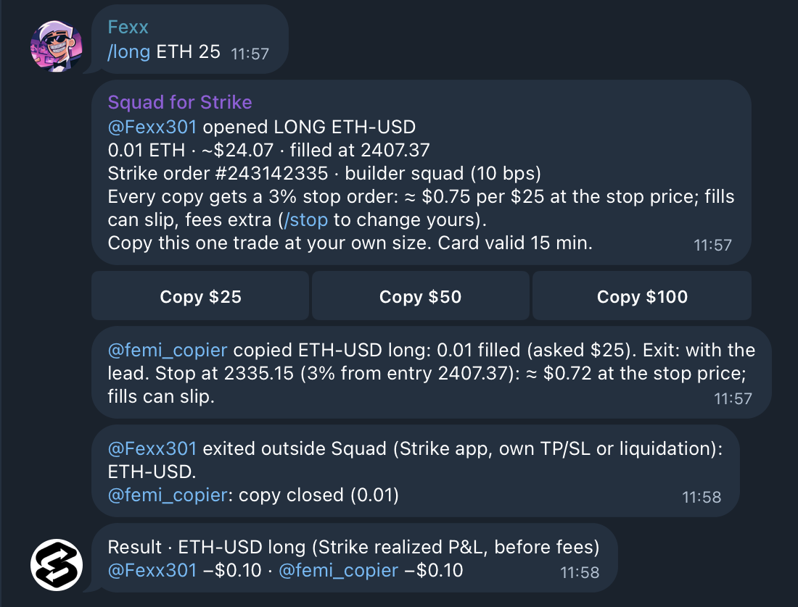

<p align="center">
  <picture>
    <source media="(prefers-color-scheme: dark)" srcset="public/squad-logo-white.svg">
    
  </picture>
</p>

# Squad — copy a trade, not a trader

Squad is a Telegram bot for trading groups on [Strike](https://strikefinance.org) perps. When a member opens a trade from the chat, the group sees a card. Anyone can copy **that one trade** at their own size with one tap, and the copy's exit stays linked: when the lead closes, even in the Strike app, Squad closes the copy too (or asks first). Every copy also gets its own stop order on Strike.

Built for the Strike Hackathon (Oct 21–23, 2026) on Strike **testnet**. Bot: [@strike_squad_bot](https://t.me/strike_squad_bot).

**▶ [Watch the demo (1:38)](https://youtu.be/ANZfTLZHglA)**

<p align="center"></p>

*A real testnet run (Oct 22). Fexx opens a long from the chat and femi_copier copies it with one tap. Fexx then closes in the Strike app, and Squad closes the copy 4.0 s later (by Strike's own trade tape) and posts both results.*

## How it works

1. **Connect once.** DM the bot `/connect`, open the one-time link, and sign with a Cardano wallet. Strike's Builder Connect gives Squad a trading-only key, and withdrawals stay locked to your wallet.
2. **A member trades from the chat.** `/long ETH 25` in the group opens the position on Strike and posts a card with the size, the real fill price and the Strike order number.
3. **Pick the trade, pick your size.** Tap **Copy $25 / $50 / $100**. The copy fills on Strike and gets its own stop order: 3% from your entry by default, and `/stop` changes it.
4. **Pick how the exit works.** By default the copy follows the lead's exit, whether the lead uses `/close` or closes in the Strike app. With `/exits ask`, you get a Close/Keep prompt instead.
5. **See the result.** Squad posts each side's realized P&L from Strike's fill history, before fees.

## Why it's different

| | Re-enter by hand | Strike native copy | Squad |
|---|---|---|---|
| What you follow | whatever you re-type | a trader's future trades, automatically (with market filters and margin caps) | one trade you pick |
| Your size | yours | a ratio or fixed amount | chosen per tap |
| Exit | watch the chat | follows the trader | follows the lead, or asks you |
| Stop | manual | a USD loss limit that ends the subscription | a stop order on each copy |
| Where it happens | app and chat | the app | the group chat |

## Built on Strike

- **Builder Connect:** members sign in with their own Cardano wallet. Squad holds a trading-only API wallet, and Strike locks withdrawals to the member's wallet.
- **Builder code:** every order Squad places carries the `squad` builder code (10 bps). After the first test session, Strike's Builder Codes dashboard showed $149.79 attributed volume and $0.06 earned.
- **Stop orders:** each copy gets a reduce-only stop order, which Strike cancels when the position closes.
- **Exit watching:** Squad reads the lead's position from Strike and closes copies when the lead goes flat, however the lead got there.

Endpoints, probes and testnet measurements: [docs/strike-integration.md](docs/strike-integration.md).

## Demonstrated on testnet

- **Exit followed from the Strike app:** the lead's close filled at 11:58:42.459 and Squad's close of the copy at 11:58:46.503 (Strike's public trade tape, Oct 22). Both results were posted: −$0.10 each, before fees.
- **Stop order:** a 0.5% stop triggered at 2475.90 and filled at 2471.54. Squad reported the real fill (−$0.17, before fees).
- **Ask mode:** the lead's `/close` sent a Close/Keep prompt. Close filled, and Strike cancelled the copy's stop.
- **Refused in the chat:** copying your own trade, a $1000 trade over the $500 cap, and a double tap.

## Try it

1. DM [@strike_squad_bot](https://t.me/strike_squad_bot) `/connect` and sign with a Cardano **preprod** wallet (Lace, Eternl…).
2. Fund your account in the [Strike testnet app](https://testnet.strikefinance.org) (Cardano deposit).
3. Add the bot to a Telegram group. One member sends `/long ETH 25`, and others tap **Copy**.
4. Close with `/close` or in the Strike app, and the copies follow.

The bot is hosted through judging (Oct 26). On testnet it trades ETH-USD only.

| Where | Command | What it does |
|---|---|---|
| DM | `/connect` | A one-time link (30 min) to sign with your Cardano wallet |
| Group | `/long ETH 25`, `/short ETH 25` | Opens a position worth ~$25 (up to $500) and posts a copy card |
| Group | `/close` | Closes your latest Squad trade; copies close or are asked |
| Any | `/exits follow` \| `/exits ask` | Copies close with the lead, or you get a Close/Keep prompt |
| Any | `/stop 3` | Stop distance for your copies, as a % from your entry (0.5–10) |

## Limits and trust

- **Testnet liquidity is ours.** Strike's testnet order books are stale, so a fourth account we control (**Maker**) quotes ±0.2% around the ETH mark, and Squad offers ETH-USD only.
- **Stops are triggers, not loss caps.** A stop order fires at its price and fills at market, so fills can slip, and fees are extra.
- **Positions are net per market, and copies live in your main account.**
  - Squad refuses a trade or a copy if that account already holds the market.
  - Every close is reduce-only and at most the copy's size, so it can't flip a position or close more than you copied.
  - If you trade that market by hand while a copy is open, a follow exit can close part of that manual position.
- **Keys:** the server holds each member's Builder Connect API-wallet key. It can trade but not withdraw. Copy sizes, the $500 cap and stops are enforced by Squad, not by the key.

Also enforced in code:
- One tap = one copy: the copy record is written before the order, so a double tap can't double-place *(unit-tested)*.
- Cards expire after 15 minutes, and a closed trade can't be copied *(unit-tested)*.
- A close claims the copy first, so two taps can't close it twice.
- If placing a stop fails, the copy message says so and Squad retries every 30 s.
- Trade commands work only in groups.

## Run it yourself

You need:
- Node 24 (no dependencies);
- a Telegram bot token from [@BotFather](https://t.me/BotFather);
- a builder code registered in the Strike testnet app;
- a Cardano preprod wallet, funded in the Strike testnet app, for each account: lead, copiers and the Maker.

```bash
cp .env.example .env   # TELEGRAM_BOT_TOKEN, BUILDER_CODE, PUBLIC_URL …
npm test               # 16 unit tests
npm start              # bot + connect page (localhost:8787) + testnet Maker
```

The first start prints a link to connect the Maker wallet, and members DM the bot `/connect`. Deployment (AWS EC2, Caddy HTTPS, secrets in SSM Parameter Store, no inbound SSH) is in `deploy/`.

```
src/strike.js   Ed25519 request signing, Builder Connect
src/connect.js  one-time links → challenge → CIP-30 signature → API wallet
src/copy.js     lead trades, copies, follow/ask exits, stop orders, exit watcher
src/maker.js    testnet liquidity (disclosed)
src/bot.js      Telegram Bot API (long polling, no SDK)
public/         wallet connect page, bech32 encoder
docs/           Strike integration details and testnet evidence
```

## Prior art and next steps

- **Prior art:** [pvp.trade](https://docs.pvp.trade) built group trading in Telegram on Hyperliquid, including copy and countertrade subscriptions. Squad brings this model to Strike, built on Strike's own pieces:
  - Cardano wallets sign in directly through Builder Connect;
  - the bot's key can trade but not withdraw;
  - orders carry a builder code.
- **Next steps:**
  - copies in Strike sub-accounts, so they're isolated from manual trading;
  - a builder code per group, so group admins earn;
  - more markets once there's live liquidity.
